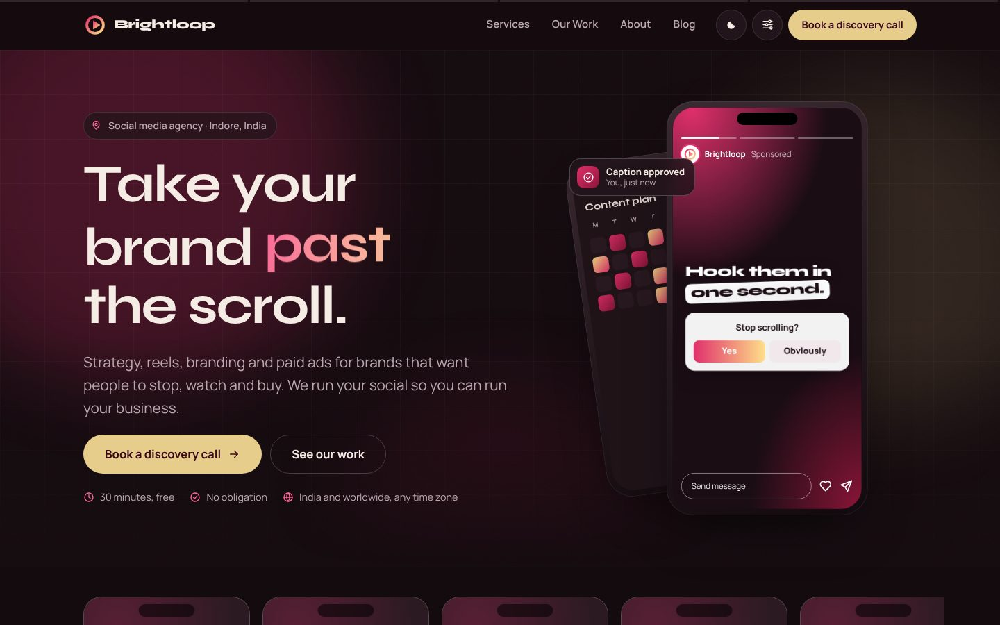
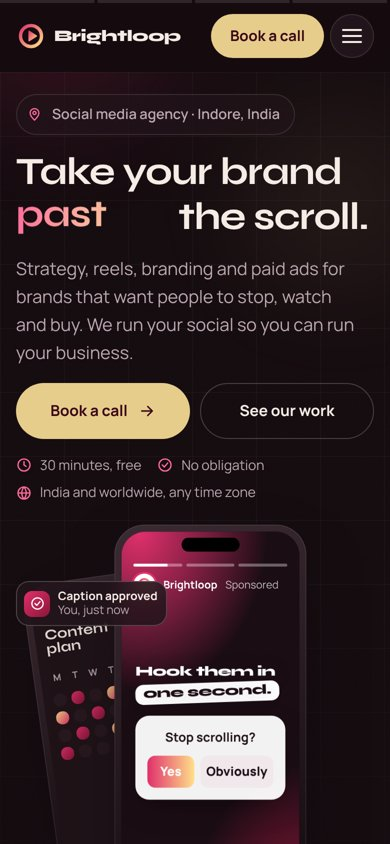

# Brightloop — social media agency website

A fast, fully responsive marketing site for a fictional social media agency, **Brightloop**. It's a demo project built to show clients what a modern agency site can look like: animated hero, reels showcase, services, case studies, a blog with a no-code editor, and booking/enquiry flows.

Plain HTML, CSS and one small JavaScript file. No framework, no database, **zero npm dependencies**.

| Desktop | Mobile |
|---|---|
|  |  |

> Brightloop is a sample brand. Names, numbers, testimonials and contact details are placeholders (search for `data-placeholder` and `REPLACE`).

## Highlights
- **Pages:** Home, Services, Our Work, About, Book a call, Blog (list, categories, posts, RSS), Privacy and 404.
- **Animated hero:** a phone playing an Instagram-style story, with workflow notifications around it.
- **Reels showcase:** a swipeable row of 9:16 reels with double-tap-to-like. On phones the row **auto-advances every 12 s**. It pauses while touched, swiped or focused, loops without rewinding, and switches off for reduced motion.
- **Built for phones:** stacked cards become swipe rows, blog lists use compact thumbnail rows, and spacing and the footer are trimmed. Tablet and desktop keep the full layout.
- **Visitor customizer:** light/dark/system, three colour themes, accent colour, corner style and motion level, applied before paint (no flash).
- **Let's talk pop-up:** Cal.com booking and a short enquiry form (Web3Forms) from any page, time-zone aware.
- **Blog with a no-code editor** at `/admin` (Decap CMS + GitHub). Supports drafts, scheduled posts, categories, search and related posts.
- **Performance and accessibility:** inlined critical CSS, self-hosted fonts, a fingerprinted script, animations paused off screen, reduced-motion support, 4.5:1 contrast and 44 px touch targets.
- **SEO:** canonical URLs, Open Graph/Twitter cards, JSON-LD (organisation, breadcrumbs, articles), sitemap, robots and RSS.

## Quick start
```bash
node -v          # needs Node.js 18 or newer
npm run dev      # builds and serves at http://localhost:5173, auto-refreshes on save
npm run build    # writes the finished site to dist/
```
On Windows you can also double-click `start-site.bat`.

## Tech
| | |
|---|---|
| Markup | Hand-written HTML pages + shared partials, stitched by `build.mjs` |
| Styles | One stylesheet (`src/assets/css/site.css`) with CSS variables for every theme |
| Script | `src/assets/js/main.js`, vanilla JS, no libraries |
| Fonts | Syne + Manrope, self-hosted WOFF2 (OFL) |
| Blog | Markdown with JSON front matter → static pages (`lib/markdown.mjs`) |
| Hosting | Any static host; ready for **Vercel** (`vercel.json`, `api/`) and Cloudflare Pages (`_headers`, `functions/`) |

## Folder layout
```
functions/api/       ← blog editor login (Cloudflare Pages Functions)
api/                 ← the same login for Vercel (thin wrappers)
vercel.json          ← Vercel settings + headers (generated by build.mjs)
lib/markdown.mjs     ← turns blog posts into HTML (safe, no dependencies)
src/
  content/blog/      ← blog posts (.md), written by hand or from /admin
  static/admin/      ← the blog editor page
  config.json        ← business details, Cal.com link, Web3Forms key, reels list (edit this first)
  pages/             ← one file per page (Home = index.html)
  partials/          ← shared head, header, footer, CTA band (edit once, every page updates)
  assets/css/site.css← all styles; colours for both modes are in section 2 "Tokens"
  assets/js/main.js  ← theme toggle, menu, reveals, reels, Cal.com, form
  assets/fonts/      ← Syne + Manrope (self-hosted WOFF2, OFL licence)
  static/            ← copied as-is: favicon, share image, reels, photos
build.mjs            ← stitches everything into dist/
dist/                ← the finished site (generated; don't edit by hand)
```

## Run it in VS Code
1. Install **Node.js LTS** from nodejs.org (one time). Check in a terminal: `node -v` should print v18 or higher.
2. VS Code → **File → Open Folder…** → choose this project folder.
3. **Terminal → New Terminal**, then run:
   ```
   npm run dev
   ```
4. Open **http://localhost:5173** (Ctrl+click the link in the terminal).
5. Edit anything in `src/` and save: the site rebuilds and the browser refreshes by itself. Stop with **Ctrl+C**.

Don't use the "Live Server" extension or double-click the HTML files: the links (`/services`, `/about`) and fonts only work through `npm run dev` or real hosting.
`npm run build` makes the final `dist/` folder without starting a server. No `npm install` is needed — there are no dependencies.

## Blog
- Posts live in `src/content/blog/` as `.md` files. The build turns them into `/blog/` (list), `/blog/<post-name>` (each post) and `/blog/category/<name>/` (one page per category that has posts), plus `/blog/feed.xml` (RSS). Every post gets share previews, Google article data and a breadcrumb.
- Post fields: title, date, description, **category**, **tags**, author, cover + description, **featured**, draft, **updated** (optional).
- The blog page shows the newest **featured** post as a large banner, then a search box, category filters and 9 posts with **Show more posts** (change `blog.postsPerPage` in `config.json`). Each post ends with 3 related posts (same category, then shared tags).
- Categories are listed in `config.json` → `blog.categories`; the editor offers them as a drop-down.
- **Status:** a post is public only when Draft is off **and** its date is today or earlier (India time). A future date = scheduled. `npm run dev` shows drafts and scheduled posts with a label; the real build never publishes them.
- **Scheduled posts go live automatically** once you move `setup/scheduled-publish.yml` to `.github/workflows/` and add the deploy hook described inside it (rebuilds the site every morning at 06:05 IST). Without it, a scheduled post goes live on the next publish or rebuild after its date.
- **Image rules:** the build refuses anything that isn't JPG, PNG, WebP, AVIF or GIF (no SVG) and warns above 500 KB. Uploaded files are served with a sandboxing header.
- Everything typed in a post is escaped, so it can't inject HTML or scripts into the site.
- The sample post `reel-hooks-that-stop-the-scroll.md` is a draft. Delete it once real posts exist.
- If there are no published posts, `/blog/` shows a friendly "coming soon" message.

### Blog editor for the client (`/admin`)
The client writes posts at **yourdomain.com/admin** using Decap CMS (free, open source). Pressing Publish saves the post to GitHub; Cloudflare rebuilds the site and the post is live in about a minute. No database.

One-time setup (about 15 minutes, after the site is on GitHub + Cloudflare Pages):
1. In `src/config.json`, set `cms.repo` to the GitHub repository, e.g. `"NIRMALKANDEL/Creative_Website"`.
2. GitHub → **Settings → Developer settings → OAuth Apps → New OAuth App**
   - Homepage URL: `https://clientdomain.com`
   - Authorization callback URL: `https://clientdomain.com/api/callback`
   - Create it, then **Generate a new client secret**.
3. Cloudflare → your Pages project → **Settings → Variables and Secrets** (on Vercel: Project → Settings → **Environment Variables**), add for Production:
   - `GITHUB_CLIENT_ID` = the Client ID
   - `GITHUB_CLIENT_SECRET` = the secret (choose **Encrypt**)
   Then redeploy.
4. The client makes a free GitHub account. In the repo → **Settings → Collaborators**, invite her with **Write** access. Only people with access to the repo can log in to /admin.
5. Send her `BLOG-GUIDE.md`.

The login code is in `functions/api/` (Cloudflare Pages Functions, free plan). If you host on Netlify instead, use Netlify's built-in GitHub login and remove `base_url`/`auth_endpoint` from the generated config.

Try the editor on your own computer without GitHub:
```
npx decap-server        # in a second terminal, next to npm run dev
```
Then open http://localhost:5173/admin/ and you'll be able to create and edit posts straight into `src/content/blog/`.

## Getting in touch: call or enquiry
- Every "Book a call" button and link opens a **Let's talk** pop-up on the page the visitor is already on. It has two tabs: **Book a call** (the Cal.com calendar) and **Send an enquiry** (a short form). On `/book` the same two options sit side by side, and the buttons just scroll there.
- **The enquiry form** asks only for name, email and what they need, plus an optional message. Phone/WhatsApp (any country code, India +91 preselected), monthly budget (currency picker, INR preselected) and a good time to call are tucked under "Add phone, budget or a good time to call".
  - The visitor's time zone and the page they came from are sent along with every enquiry.
  - If something is missing, the fields are flagged and nothing typed is lost. After sending, a "Thanks, <name>" panel appears.
- **Time zones:** India (IST, UTC+5:30) is home. Visitors outside India see their own zone named, with the current time there and in Indore. Cal.com shows slots in the visitor's zone and lets them change it.
- **Until `calLink` is filled in** `config.json`, the pop-up opens on the enquiry tab and the call tab says online booking isn't switched on yet. It never shows a fake confirmation.
- **Until `web3formsKey` is filled in**, the form says the message wasn't sent and keeps the text.
- **Location:** `config.json` → `location` (Indore, Madhya Pradesh, India; add `streetAddress`/`postalCode` only if you want them public) feeds the footer and Google's business data. `phone` is optional.

## Themes and the visitor customizer
Visitors can change the look from the sliders button in the header (or **Customize look** in the phone menu):
- **Appearance:** System, Light or Dark.
- **Theme:** Cherry (the house colours, default), Grape (Instagram purple/magenta) or Sunset (coral/gold). Each has a light and a dark version.
- **Accent colour, Corners** (rounded / soft / sharp) and **Motion** (full / calm / off).
- **Reset to default** clears everything.

Choices are saved in the visitor's browser (`localStorage` key `wb-look`) and applied by a tiny script in `<head>` before the page paints, so there is no flash. All palettes live in `site.css` section 2 as CSS variables; every text, accent and button colour pair is checked at 4.5:1 or better. To add a palette, copy the `[data-palette="grape"]` blocks, then add a card for it in `src/partials/header.html` and its name to `ALLOWED.palette` in `main.js`.

## Motion
- The home hero is a phone playing a 3-slide Instagram story, with "caption approved / reel scheduled / report ready" notifications around it. It pauses on hover.
- The bar along the top of the header fills like story progress as you scroll.
- Pages cross-fade into each other (View Transitions; Chrome, Edge and Safari 18+). A blog card's image grows into the post's banner.
- Double-tap (or double-click) a reel to drop a heart.
- Everything uses transform/opacity only. Device "reduce motion" always switches it off; visitors can also pick Calm or Off.

## Look settings (brightness, glow, motion)
Change `look` in `src/config.json`, then run `node build.mjs`.

| Setting | Values | What it changes |
|---|---|---|
| `preset` | `calm` (default) · `balanced` · `vivid` | Sets all of the below at once |
| `glow` | 0 – 1 | Background glows behind the hero, CTA, reels and photos |
| `grain` | 0 – 1 | Film-grain texture (keep under 0.06) |
| `grid` | 0 – 1 | Faint grid lines behind page headings |
| `spotlight` | 0 – 1 | Cursor glow on cards (desktop) |
| `shimmer` | 0 or 1 | Shine sweep across the main button |
| `motion` | `calm` · `normal` · `off` | Speed of drifting glows and the scrolling strip; `off` stops all decorative motion |
| `buttons` | `soft` · `bright` | Muted or full-strength butter/cherry buttons |
| `defaultTheme` | `system` · `dark` · `light` | Mode shown until the visitor picks one with the toggle |

Example: calm but with no grid and the old bright buttons:
```json
"look": { "preset": "calm", "grid": 0, "buttons": "bright", "defaultTheme": "system" }
```
Visitors who switch on "reduce motion" on their phone always get no motion, whatever the setting.

## Go-live checklist
1. **config.json** — replace every `REPLACE` value (domain, email, Instagram, Cal.com link, Web3Forms key).
2. **Logo** — put the client's SVG in `src/static/` and swap the `LOGO` constant in `build.mjs` for an `` (use light/dark versions with the `data-theme` attribute). Replace `src/static/favicon.svg`, `apple-touch-icon.png`, `og-image.png`.
3. **Brand colours** — paste the brand kit hex values into section 2 of `site.css`. Keep body text at 4.5:1 contrast in both modes.
4. **Reels** — add MP4s (H.264, muted, under 1 MB each at phone size, 9:16) to `src/static/assets/reels/`, a poster JPG/WebP for each, then fill the `reels` list in `config.json`:
   `{ "src": "/assets/reels/reel-1.mp4", "poster": "/assets/reels/reel-1.webp", "label": "Brand name" }`
5. **Placeholders** — search `data-placeholder` in `src/pages/` and replace each block with approved content (stats, testimonials, case studies, founder story and photo, team, FAQ answers, privacy date). Remove the `ph-tag` label when done. The build count should reach 0.
6. **Counters** — when real numbers are approved, use `<span class="stat-value grad-text" data-count="120" data-suffix="+">0</span>` and they animate on scroll.
7. **Packages** — in `services.html`, remove `hidden` from the packages section if prices are to be shown.
8. **Web3Forms** — restrict the access key to the client's domain in the Web3Forms dashboard.
9. **Cal.com** — event "Discovery call", 30 min, availability in Asia/Kolkata; the embed shows times in the visitor's zone automatically.

## Deploy on Vercel (recommended)
Everything is preconfigured in `vercel.json` (build command, `dist` output, clean URLs, security and cache headers) and `api/` (blog editor login).
1. Push this repo to GitHub.
2. [vercel.com/new](https://vercel.com/new) → **Import** `NIRMALKANDEL/Creative_Website`.
3. Leave the settings Vercel shows (Framework: *Other*; it reads the build command and output folder from `vercel.json`) → **Deploy**.
4. Your site is live at `https://<project>.vercel.app`. Every push to `main` redeploys automatically; pull requests get preview links.
5. Optional:
   - **Custom domain:** Project → Settings → Domains. Then set `siteUrl` in `src/config.json` (or a `SITE_URL` environment variable) to that domain so canonical and share links use it. Until then, the build uses the `.vercel.app` address automatically.
   - **Blog editor at /admin:** create the GitHub OAuth App as described in *Blog editor* above (callback `https://<your-domain>/api/callback`), then add `GITHUB_CLIENT_ID` and `GITHUB_CLIENT_SECRET` in Project → Settings → Environment Variables and redeploy.

`vercel.json` is generated by `node build.mjs`. If the build prints *vercel.json updated*, commit it.

## Deploy (Cloudflare Pages)
1. Push this folder to a GitHub repo (this one: `NIRMALKANDEL/Creative_Website`).
2. Cloudflare → Workers & Pages → Create → Pages → connect the repo.
3. Build command: `node build.mjs` · Output directory: `dist`.
4. Custom domains → add the client's domain, follow the DNS steps.
5. Turn on Web Analytics for the project (cookie-free; no code needed).
6. Open the preview, book a test call and send a test form. Check the browser console: the Content-Security-Policy is **Report-Only** at first. If there are no violations, rename `Content-Security-Policy-Report-Only` to `Content-Security-Policy` in `build.mjs` and redeploy.
7. Run PageSpeed Insights on every page, on mobile.

Netlify fallback: same build command and folder; move the `_headers` rules into Netlify's `_headers` (same format).

## Notes
- Clean URLs (`/services`, not `/services.html`) work automatically on Cloudflare Pages and Netlify.
- Theme: follows the visitor's device; the header toggle overrides it and is remembered. A tiny inline script sets it before paint, so there is no flash.
- Motion stops for visitors who have "reduce motion" switched on.
- Meta Pixel is not installed. If the client wants it, add a consent banner first.

## Tests (optional, for developers)
`tests/e2e.mjs` checks every page on phone, tablet and desktop sizes (errors, broken images, overflow, links, SEO tags), the theme customizer, blog search/filters/drafts/scheduling, mobile menu, reduced motion and the booking form. It uses fake posts from `tests/fixtures/posts`, which never reach the real site.
```
npm i -D playwright && npx playwright install chromium     # once
# PowerShell:  $env:BLOG_DIR="tests/fixtures/posts"; node build.mjs
# macOS/Linux: BLOG_DIR=tests/fixtures/posts node build.mjs
npx serve dist -l 5173        # in a second terminal
node tests/e2e.mjs
npm run build                 # afterwards, rebuild the real site
```

## Licence
Code: free to reuse for your own projects. Fonts: SIL Open Font License (see `src/assets/fonts/`). Brightloop is a fictional brand.
